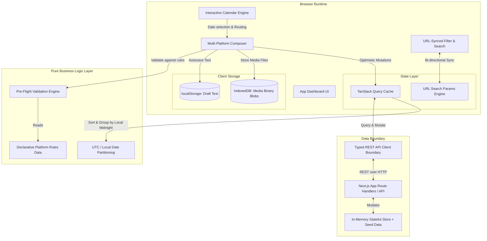

# Flintzy Architecture Documentation
> **Comprehensive System Design & Architectural Decision Records (ADRs)**

---

## 1. Executive Summary & System Topology

Flintzy is a client-first, high-reliability social media post scheduling and queue management engine built on **Next.js 15 (App Router)** and **React 19**. It is architected specifically to eliminate upstream publishing failures (silent API rejections, media dimension mismatches, character truncation, and timezone synchronization drift) before network dispatch occurs.



---

## 2. Core Architectural Principles

1. **Rule of Pre-Flight Enforcement**: Never allow an invalid post into the network queue. Any constraint known ahead of time (character counts, aspect ratio, media requirements, schedule timestamp in the past) must be caught deterministically by client-side validation before scheduling.
2. **Platform Configuration as Pure Data**: No platform rules (character caps, required media, API rate behavior) are hardcoded inside UI components. All behaviors stem from a central configuration schema in [`src/config/platforms.ts`](file:///home/thirdweb/work/socialmedia-posts-schedular-flintzy/src/config/platforms.ts). Adding or modifying a platform takes under 15 lines of code.
3. **Strict Separation of Pure Logic and UI**: Date conversions, collision detection, post filtering, and validation algorithms are written as pure, framework-agnostic TypeScript functions covered by unit tests.
4. **Resilient Local Persistence**: Prevent user data loss at all costs. Draft text is saved to `localStorage`, large media blobs are cached in `IndexedDB`, and browser unload triggers protective confirmation prompts when unsaved changes exist.

---

## 3. State Ownership & Partitioning Strategy

State in Flintzy is deliberately stratified to ensure single sources of truth without synchronization anomalies:

| State Class | Technology | Scope & Responsibility | Survival Boundary |
| :--- | :--- | :--- | :--- |
| **Server / Entity State** | **TanStack Query (v5)** | Post entities, queue statuses, bulk retry actions, optimistic rollback snapshots | Session / In-Memory Cache |
| **Filter & Navigation State** | **Next.js `useSearchParams`** | Active platforms, status filter (`all`, `failed`, `scheduled`), search query `q`, selected calendar date | Survives Page Refresh & Shareable via URL |
| **Draft Text State** | **`localStorage`** | Composer message, per-platform caption overrides, target platform selections | Survives Browser Crash / Tab Close |
| **Draft Media State** | **IndexedDB (`draftMediaDb`)** | High-resolution image/video files, raw blobs, Base64 data URLs | Survives Tab Reload without LocalStorage 5MB quota errors |
| **Transient UI State** | **React `useState` / `useRef`** | Modal visibility, popover auto-flip coordinates, drag-and-drop hover state | Component Unmount |

---

## 4. Key Architectural Decisions (ADRs)

### ADR 01: Declarative Platform Configuration as Pure Data
* **Status**: Accepted
* **Context**: Multi-channel social tools frequently degrade into nested `if (platform === 'twitter')` or `if (platform === 'instagram')` checks scattered across forms, previews, and list items.
* **Decision**: Define a single strongly-typed `PlatformConfig` interface in [`src/config/platforms.ts`]:
  ```typescript
  export interface PlatformConfig {
    id: PlatformId;
    name: string;
    maxCharacters: number;
    requiresMedia: boolean;
    allowedMediaTypes: ('image' | 'video')[];
    aspectRatios: string[];
    // ... UI icons and theme tokens
  }
  ```
* **Consequences**:
  - Components like `PlatformPreview`, `PlatformSelector`, and `validation.ts` iterate over the config.
  - Adding LinkedIn or TikTok required zero rewrites to existing components.
  - Unit tests can validate platform compliance against programmatic rule sets.

---

### ADR 02: Timezone & Chrono-Partitioning Architecture
* **Status**: Accepted
* **Context**: Social media scheduling spans multiple timezones. A naive `postDate.toDateString()` or UTC date comparison creates midnight clipping bugs where a 23:45 local post displays on tomorrow's calendar day.
* **Decision**:
  1. **Canonical Storage**: All scheduled times are transmitted and stored strictly in **ISO 8601 UTC** (`YYYY-MM-DDTHH:mm:ss.sssZ`).
  2. **Local Day Boundary Math**: Day difference calculation (`getCalendarDayDifference`) strips time components in the **user's local timezone** and computes integer day deltas relative to local midnight:
     - `delta === 0` -> **"Today"**
     - `delta === 1` -> **"Tomorrow"**
     - `delta > 1` -> Formatted localized day header (e.g., `Thursday, Oct 24`)
     - `delta < 0` -> **"Earlier"** (historical/failed/published)
  3. **Round-Trip Input Preservation**: Converting user input from `<input type="date">` and `<input type="time">` creates a local `Date` object before converting to `.toISOString()`, ensuring complete round-trip integrity.

---

### ADR 03: Optimistic UI Mutations with Cache Rollback
* **Status**: Accepted
* **Context**: Network latency during post retry or deletion makes dashboards feel sluggish. Failed posts need instant user feedback.
* **Decision**: Implement TanStack Query `onMutate` optimistic updates:
  ```mermaid
  sequenceDiagram
      actor User
      participant UI as Post Card UI
      participant Cache as TanStack Query Cache
      participant Server as Next.js API Route

      User->>UI: Clicks "Retry Post"
      UI->>Cache: Cancel outgoing queries & snapshot previous state
      Cache-->>UI: Optimistically update post status to "scheduled"
      UI-->>User: Immediate visual feedback (spinner/scheduled badge)
      UI->>Server: POST /api/posts/[id]/retry
      alt Server Returns 200 OK
          Server-->>Cache: Returns updated post entity
          Cache-->>UI: Finalize state
      else Server Returns 500 Failure (Simulated 20%)
          Server-->>Cache: Error response
          Cache->>Cache: Rollback to previous snapshot
          Cache-->>UI: Revert status to "failed"
          UI-->>User: Trigger Sonner error toast with "Try again" action
      end
  ```
* **Consequences**:
  - The UI responds in sub-5ms.
  - Failed network calls automatically revert without state desynchronization.
  - Deletions feature a 5-second non-blocking **Undo** toast window.

---

### ADR 04: Two-Tier Storage for Media Draft Persistence
* **Status**: Accepted
* **Context**: `localStorage` has a strict ~5MB quota limit. Saving high-resolution video files or multiple images causes `QUOTA_EXCEEDED_ERR`, crashing the composer.
* **Decision**: Split draft storage into two tiers:
  - **Tier 1 (Text & Metadata)**: Stored in `localStorage` (`flintzy_composer_draft`) for instant synchronous restoration on reload.
  - **Tier 2 (Media Payloads)**: Stored in an **IndexedDB** object store (`flintzy_draft_media`) via [`src/lib/storage/draftMediaDb.ts`](file:///home/thirdweb/work/socialmedia-posts-schedular-flintzy/src/lib/storage/draftMediaDb.ts). Handles large binary Blobs, Files, and Base64 Data URLs asynchronously with quota detection.

---

### ADR 05: Auto-Flip Collision Detection for Popovers
* **Status**: Accepted
* **Context**: Date pickers and dropdown filters rendered near the bottom or edges of the viewport clip off-screen on laptops and mobile devices.
* **Decision**: Implemented viewport-aware collision measurement in [`src/components/ui/popover.tsx`](file:///home/thirdweb/work/socialmedia-posts-schedular-flintzy/src/components/ui/popover.tsx):
  - Traverses scrollable ancestor elements and checks `triggerRect.bottom + popoverHeight > viewportHeight`.
  - Automatically flips alignment from `bottom` to `top` when vertical clearance is below threshold.
  - Fully unit-tested with mocked DOM bounding boxes.

---

## 5. Security & Dependency Governance

* **RSC / Next.js Hardening**: All dependencies are secured against **CVE-2025-55182** (React2Shell) by enforcing Next.js `>=15.1.11` and modern React 19 runtime dependencies.
* **Node Types Alignment**: `@types/node` is set to `^22` to satisfy Vitest 5+ and modern ES engine peer dependencies without `ERESOLVE` conflicts.
* **Package Manager**: Governed by `pnpm` (Corepack-compatible) via `"packageManager": "pnpm@10.18.2"` in [`package.json`](file:///home/thirdweb/work/socialmedia-posts-schedular-flintzy/package.json) to eliminate phantom dependencies and accelerate CI builds.

---

## 6. Production Scaling Roadmap

```text
Current Architecture (Client Cache + Mock API)
                     │
                     ▼
Next Phase: Distributed Production Architecture
├── Compute Layer: Next.js on Vercel Serverless / Edge
├── Database: PostgreSQL (Prisma or Drizzle ORM) with connection pooling
├── Queue Engine: Redis BullMQ / Upstash for background scheduling dispatches
├── Storage Layer: AWS S3 or Cloudflare R2 with Presigned Upload URLs
└── Auth: Clerk / NextAuth session verification on API route handlers
```
